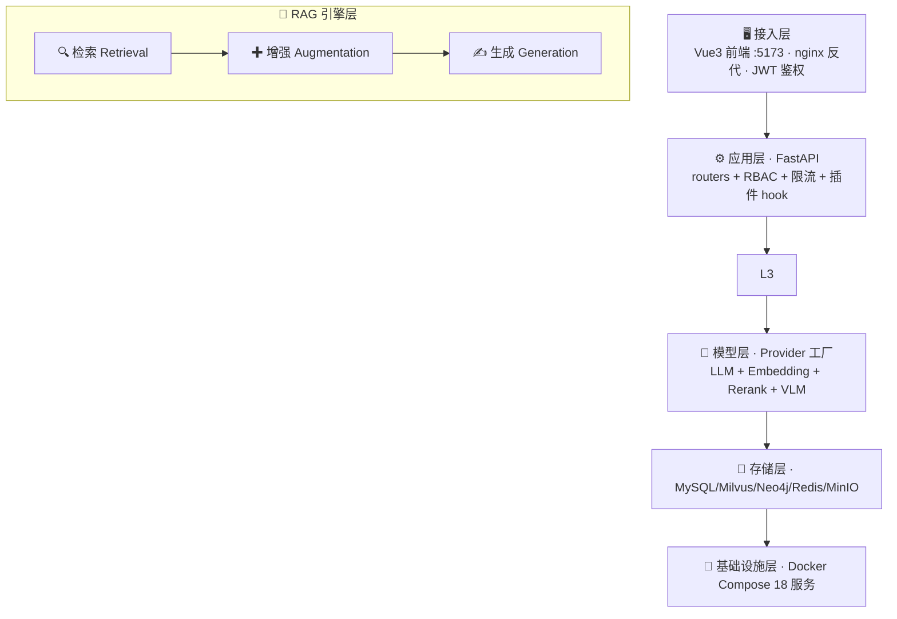

# 电网运维 RAG 智能问答系统 · Code Wiki

> 本文档面向开发者与维护者，系统梳理项目整体架构、模块职责、关键类/函数、依赖关系与运行方式。
> 项目定位：基于大模型 + RAG 的电网自主运维智能问答系统，覆盖变电 / 配电 / 输电场景，强监管行业（安全合规、RBAC、多租户、可观测为硬约束）。

---

## 目录

1. [项目概述](#1-项目概述)
2. [整体架构](#2-整体架构)
3. [后端架构（backend/app）](#3-后端架构backendapp)
4. [前端架构（frontend/src）](#4-前端架构frontendsrc)
5. [数据存储职责](#5-数据存储职责)
6. [基础设施与服务编排](#6-基础设施与服务编排)
7. [关键类与函数说明](#7-关键类与函数说明)
8. [依赖关系](#8-依赖关系)
9. [项目运行方式](#9-项目运行方式)
10. [测试体系](#10-测试体系)
11. [关键设计约定](#11-关键设计约定)
12. [附录：目录结构](#12-附录目录结构)

---

## 1. 项目概述

| 项 | 说明 |
| --- | --- |
| **项目名称** | 电网运维 RAG 智能问答系统 |
| **技术栈** | FastAPI（后端）+ Vue 3（前端）+ Docker Compose |
| **核心能力** | 自然语言提问 → 智能路由 → 混合检索 → 三级缓存 → CRAG 自纠错 → 可信答案生成 |
| **大模型支持** | DeepSeek / 阿里百炼（Qwen）/ 火山方舟（Doubao），本地 Ollama 兜底 |
| **向量检索** | 双 Embedding：云 1024 维 + 本地 bge 512 维，独立 Milvus collection |
| **知识增强** | GraphRAG（Neo4j 设备-故障-处置多跳）、知识自进化、证据缺口补全 |
| **可观测** | Prometheus + Grafana + Langfuse（OTel OTLP） |
| **项目入口** | `backend/app/main.py` |
| **API 前缀** | `/api` |

---

## 2. 整体架构

### 2.1 六层分层架构



### 2.2 核心数据流

用户提问 → API 层鉴权限流 → 三级缓存命中检查 → 多轮指代消解 → 智能路由 → 混合检索 → CRAG 自纠错 → GraphRAG 增强 → LLM 流式生成 → 引用校验 → 缓存回写 → 异步质量评估 / 证据缺口收集。

---

## 3. 后端架构（backend/app）

### 3.1 模块职责一览

| 目录 | 职责 |
| --- | --- |
| `routers/` | 定义 HTTP / WebSocket 端点，保持“薄”：参数校验、权限校验、调用 service。 |
| `services/` | 承载全部业务逻辑：问答编排、检索、文档处理、缓存、反馈、任务调度等。 |
| `rag/` | RAG 核心算法：CRAG 自纠错、RRF/MMR 重排、引用自动补标与校验、prompt 模板、语义缓存等。 |
| `providers/` | 按配置实例化 LLM / Embedding provider，并封装 fallback + 健康熔断 + 档位分档。 |
| `routing/` | 基于 query 特征决策检索路径（sparse / dense / hybrid / sparse_first）。 |
| `clients/` | 封装 Milvus、MinIO、Redis、Neo4j、Nacos 等外部组件的低级客户端。 |
| `core/` | 跨层基础设施：统一响应体、RBAC、限流、指标、降级观测、安全、OTel trace、QA trace。 |
| `models/` | SQLAlchemy ORM 实体（文档、chunk、会话、反馈、知识图谱三元组等）。 |
| `schemas/` | Pydantic 模型，校验请求/响应并用于 OpenAPI 文档。 |
| `db/` | 异步 SQLAlchemy session、建表与初始管理员。 |
| `tasks/` | 持久化后台任务队列与 worker 生命周期。 |
| `events/` | 领域事件定义与 worker。 |
| `mcp/` | MCP 外部工具总线：发现/注册外部 server、暴露本地 server、SCADA mock。 |

### 3.2 入口与配置

#### `backend/app/main.py`

FastAPI 应用入口，所有后台 cron 循环在 `lifespan` 中装配。

主要启动步骤：

1. `setup_logging()` 初始化日志。
2. `run_startup_check()` 安全自检（默认密钥/口令 → WARN）。
3. 等待 MySQL 启动（`STARTUP_DEPENDENCY_RETRIES` 控制，默认 0 即不等待）。
4. Nacos 配置覆盖（`CONFIG_SOURCE=nacos` 时）。
5. `init_db()` 建表 + 初始管理员。
6. `init_bucket()` 确保 MinIO bucket。
7. `ensure_collections()` 确保 Milvus collection（`grid_chunks`、`grid_chunks_bge`）。
8. `ensure_memory_collection()` 确保记忆 collection。
9. bge 模型预热（懒加载会让首问卡 ~80s，启动期预热避免）。
10. Neo4j 约束/索引初始化。
11. OpenTelemetry（OTLP → Langfuse）初始化。
12. MCP registry 加载外部 server。
13. 挂载全部 router，启动后台 cron（健康探活、缓存预热、备份、KG 对账、证据补全、知识自进化等）。

#### `backend/app/config.py`

全局配置单例，使用 `pydantic-settings` 读取根目录 `.env`，导出 `settings` 对象。

关键设计：

- 所有 feature flag 默认 `False` = 现状行为（新增高级能力默认关闭）。
- 缓存 key 版本串由 `citation_cache_version()` 生成，包含 citation 开关、治理代际 `G`、CRAG V3 / PERDOC、LLM_TIER_FACT_FAST、注入拦截档等。开关变化 → key 变化 → 旧缓存自动失效。
- 治理代际 `_gov_generation` 进程内存镜像，由 `bump_gov_generation_inproc()` 递增。

部分关键配置默认值（当前代码）：

| Flag | 默认值 | 说明 |
| --- | --- | --- |
| `ROUTING_ENABLE` | `True` | 智能路由选择检索路径 |
| `RERANK_ENABLE` | `True` | 云 rerank |
| `MMR_ENABLE` | `True` | MMR 多样性重排 |
| `CRAG_ENABLE` | `True` | Corrective RAG 检索自纠错 |
| `CRAG_V3_ENABLE` | `False` | 连续置信度 + 归因 + 决策矩阵 |
| `CRAG_PERDOC_ENABLE` | `False` | CRAG v2：LLM 逐条评估证据 |
| `CITATION_AUTO_ENABLE` | `True` | 无角标句子自动向量补标 |
| `CITATION_VERIFIER_ENABLE` | `True` | 可核验引用校验引擎总开关 |
| `CITATION_NLI_ENABLE` | `False` | NLI 精准核验（最重） |
| `KG_RAG_ENABLE` | `True` | 问答融合知识图谱 |
| `KG_AUTO_EXTRACT_ENABLE` | `True` | 文档向量化后自动抽三元组 |
| `STANDALONE_REWRITE_ENABLE` | `True` | 多轮指代消解 |
| `LLM_TIER_FACT_FAST_ENABLE` | `True` | 事实型短问走 turbo |
| `HOTQA_ENABLE` | `True` | 高频问答对永久缓存 |
| `CACHE_PERSIST_ENABLE` | `True` | MySQL 二级缓存双写 |
| `SMALL_TO_BIG_ENABLE` | `True` | 小块检索 + 父块扩展 |

### 3.3 核心流程：问答主链路

以 `POST /api/qa/answer` 为例：

| 步骤 | 涉及文件 | 说明 |
| --- | --- | --- |
| 1. 路由入口 | `routers/qa.py::answer` | 校验 JWT 与 `qa:answer` 权限，创建 QA trace collector。 |
| 2. 预处理 | `services/qa_service.py::answer` | 归一化 query、注入检测。 |
| 3. 缓存命中 | `services/qa_service.py` | L1 Redis → L2 MySQL → L1.5 Semantic；仅单轮走缓存。 |
| 4. 多轮消解 | `services/standalone_query.py` | 将追问改写成独立查询（仅用于检索）。 |
| 5. 智能路由 | `routing/routing_service.py` + `routing/query_classifier.py` | 6 维特征 → sparse/dense/hybrid/sparse_first。 |
| 6. 混合检索 | `services/retrieval_service.py` | 双路向量 + BM25 → RRF → rerank → MMR → small-to-big → ACL 过滤。 |
| 7. CRAG 自纠错 | `rag/crag.py` / `rag/crag_v2.py` | correct/ambiguous/incorrect 分级；incorrect 触发改写重检索，仍低 → refused。 |
| 8. 图谱增强 | `services/kg_service.py` | Neo4j 设备-故障-处置结构化上下文。 |
| 9. LLM 生成 | `providers/factory.py` + `providers/llm_router.py` | 档位分档 → provider 选择 → fallback 链 → 流式生成。 |
| 10. 引用校验 | `rag/citation.py` + `rag/citation_verifier.py` | 自动补标 + 格式/向量/NLI 三层校验。 |
| 11. 落库缓存 | `services/qa_service.py` | 保存会话、高置信单轮写入缓存、记录成本与在线 eval。 |
| 12. 异步闭环 | `services/knowledge_evolution_service.py` 等 | LLM-judge、证据缺口收集、dislike 沉淀。 |

### 3.4 关键 Router 与 Service

#### Routers

| 文件 | 主要职责 |
| --- | --- |
| `routers/qa.py` | 问答（`/answer`、`/answer/stream`、`/answer/ws`）、反馈、会话、收藏、导出。 |
| `routers/document.py` | 文档上传、解析、向量化、版本、权限。 |
| `routers/kg.py` | 知识图谱查询、三元组管理、重建。 |
| `routers/retrieval.py` | 检索调试、检索来源、trace。 |
| `routers/domain.py` | 故障诊断、相似案例、两票。 |
| `routers/system.py` | 用户/配置/备份/运行时信息/feature-flags。 |
| `routers/knowledge_governance.py` | 知识治理（撤回、过期、代际传播）。 |
| `routers/knowledge_evolution.py` | 知识自进化扫描与回流。 |
| `routers/ops_workbench.py` | 运维工作台（独立功能，默认关）。 |
| `routers/task_center.py` | 持久化任务与事件中心。 |
| `routers/quality_event.py` | 质量事件总线。 |
| `routers/realtime_event.py` | 实时事件/主动运维接入。 |
| `routers/workflow.py` | DAG 工作流编排（功能开关 `WORKFLOW_ENABLE`）。 |
| `routers/ops_report.py` | 运维报告生成（功能开关 `OPS_REPORT_ENABLE`）。 |
| `routers/doc_collab.py` | 文档协作批注与电子签批（功能开关 `DOC_COLLAB_ENABLE`）。 |
| `routers/drill.py` | 故障仿真演练沙箱（功能开关 `DRILL_SANDBOX_ENABLE`）。 |
| `routers/twin.py` | 数字孪生变电站 3D。 |
| `routers/memory.py` | Agent 长期记忆。 |
| `routers/notification.py` | 通知中心。 |
| `routers/integrations.py` | 外部集成（如 LLM User 套件）。 |

#### Services（核心）

| 文件 | 主要职责 |
| --- | --- |
| `services/qa_service.py` | 问答编排核心。 |
| `services/retrieval_service.py` | 混合检索与精排。 |
| `services/document_service.py` | 文档生命周期管理。 |
| `services/conversation_service.py` | 多轮会话消息管理。 |
| `services/feedback_service.py` | 用户反馈处理。 |
| `services/standalone_query.py` | 多轮指代消解。 |
| `services/query_rewrite.py` | query 改写与重检索。 |
| `services/config_service.py` | 运行时热配置（Redis `config:*`）。 |
| `services/kg_service.py` | 知识图谱查询与增强。 |
| `services/cache_warmup.py` / `cache_persist.py` | 缓存预热与持久化。 |
| `services/evidence_gap_service.py` | 证据缺口收集与补全。 |
| `services/knowledge_evolution_service.py` | 知识自进化闭环。 |
| `services/knowledge_governance_service.py` | 知识治理。 |
| `services/online_eval_service.py` | 线上 faithfulness 评估。 |
| `services/qa_trace_service.py` | QA trace 落库与查询。 |
| `services/agent_runtime.py` | 通用 Agent 引擎。 |
| `services/agent_personas.py` | Agent persona 定义。 |
| `services/agent_tools.py` | Agent 工具注册。 |
| `services/task_center_service.py` | 任务队列调度。 |
| `services/quality_event_service.py` | 质量事件总线。 |

### 3.5 RAG 算法模块（backend/app/rag/）

| 文件 | 主要职责 |
| --- | --- |
| `rag/crag.py` | CRAG 分级与置信度计算（correct/ambiguous/incorrect）。 |
| `rag/crag_v2.py` | LLM 逐条证据评估（per-doc）。 |
| `rag/rrf.py` | RRF 多路排名融合。 |
| `rag/mmr.py` | MMR 多样性重排。 |
| `rag/citation.py` | 答案引用自动补标、句级溯源。 |
| `rag/citation_verifier.py` | 格式/向量/NLI 三层引用校验。 |
| `rag/citation_index.py` | 引用编号索引构建。 |
| `rag/prompt_templates.py` | 所有 LLM prompt 模板集中管理。 |
| `rag/semantic_cache.py` | 语义缓存 L1.5。 |
| `rag/judge.py` | 离线/在线 LLM-judge（幻觉、可答性）。 |
| `rag/hyde.py` | HyDE 假设文档检索。 |
| `rag/multi_query.py` | 多查询分解。 |
| `rag/raptor.py` | RAPTOR 层次化摘要检索。 |
| `rag/cim_parser.py` | CIM 模型解析。 |

### 3.6 Provider 工厂（backend/app/providers/）

| 文件 | 主要职责 |
| --- | --- |
| `providers/factory.py` | `get_llm_provider()` / `get_embedding_provider()`。 |
| `providers/llm_router.py` | L0 fallback 链、L1 健康熔断、L2 turbo/plus 分档。 |
| `providers/base.py` | Provider 抽象基类。 |
| `providers/llm/deepseek_llm.py` | DeepSeek LLM 实现。 |
| `providers/llm/qwen_llm.py` | 阿里百炼 Qwen LLM 实现。 |
| `providers/llm/doubao_llm.py` | 火山方舟 Doubao LLM 实现。 |
| `providers/llm/ollama_llm.py` | 本地 Ollama 兜底实现。 |
| `providers/embedding/qwen_embedding.py` | 云 Qwen embedding。 |
| `providers/embedding/doubao_embedding.py` | 云 Doubao embedding。 |
| `providers/embedding/bge_embedding.py` | 本地 bge embedding。 |

### 3.7 横切核心（backend/app/core/）

| 文件 | 主要职责 |
| --- | --- |
| `core/permissions.py` | RBAC 权限常量与角色-权限映射。 |
| `core/dependencies.py` | `get_current_user`、`require_perm` 等依赖。 |
| `core/response.py` | 统一 `{code, message, data}` 响应，`BizError` → HTTP 200。 |
| `core/obs.py` | `degraded()` 降级观测，记录 `DEGRADED{tag}` 指标。 |
| `core/metrics.py` | Prometheus 业务指标与预注册。 |
| `core/limiter.py` | slowapi 限流。 |
| `core/safety.py` | prompt injection 检测与 PII 脱敏。 |
| `core/security.py` / `security_check.py` | JWT 相关与安全自检。 |
| `core/qa_trace.py` | 单请求 trace collector（瀑布图）。 |
| `core/otel_genai.py` | OpenTelemetry OTLP 初始化。 |
| `core/logging.py` | 结构化日志配置。 |
| `core/ws_manager.py` | WebSocket 连接管理。 |

### 3.8 数据模型（backend/app/models/）

| 文件 | 主要职责 |
| --- | --- |
| `models/document.py` | 文档元数据与 ACL。 |
| `models/document_version.py` | 文档版本。 |
| `models/chunk.py` | 文本 chunk 与父块关系。 |
| `models/conversation.py` | 会话与消息。 |
| `models/feedback.py` | 用户反馈。 |
| `models/favorite.py` | 收藏。 |
| `models/qa_cache.py` | MySQL 二级缓存。 |
| `models/qa_trace.py` | QA trace 落库。 |
| `models/kg_triple.py` | 知识图谱三元组 MySQL 镜像。 |
| `models/knowledge_governance.py` | 治理记录。 |
| `models/knowledge_evolution.py` | 自进化草稿。 |
| `models/evidence_gap.py` | 证据缺口。 |
| `models/quality_event.py` | 质量事件。 |
| `models/persistent_task.py` | 持久化任务。 |
| `models/user.py` | 用户与角色。 |
| `models/permission.py` | 权限数据。 |
| `models/ops_workbench.py` | 运维工作台数据。 |
| `models/ops_report.py` | 运维报告。 |
| `models/doc_collab.py` | 文档协作批注与签批。 |
| `models/drill.py` | 演练沙箱。 |
| `models/workflow.py` | 工作流定义与执行。 |
| `models/ticket.py` | 两票工单。 |
| `models/alert_disposal.py` | 告警处置。 |
| `models/realtime_event.py` | 实时事件。 |
| `models/notification.py` | 通知。 |
| `models/agent_memory.py` | Agent 长期记忆。 |
| `models/agent_tool_call.py` | Agent 工具调用审计。 |
| `models/persona_config.py` | Persona 配置。 |

---

## 4. 前端架构（frontend/src）

### 4.1 技术栈

- **框架**：Vue 3.4.38 + Vue Router 4.4.3
- **状态管理**：Pinia 2.2.4
- **构建工具**：Vite 5.4.3
- **HTTP 库**：axios 1.7.7
- **工具库**：@vueuse/core 14.3.0
- **可视化**：echarts 6.1.0、three 0.128.0
- **Markdown / 代码高亮**：markdown-it 14.2.0、highlight.js 11.11.1
- **部署**：nginx:alpine 容器托管静态资源

### 4.2 目录职责

| 目录 | 职责 |
| --- | --- |
| `api/` | 后端接口封装：`request.js` axios 实例与拦截器；`index.js` 按业务域导出 API 函数。 |
| `views/` | 全部页面组件。 |
| `components/` | 复用组件（AgentTrace、QaTraceChart 等）。 |
| `router/` | 路由定义、鉴权守卫、角色白名单。 |
| `stores/` | Pinia 状态（auth 等）。 |
| `utils/` | 工具函数：`perm.js` 镜像后端 RBAC 用于按钮/菜单显隐。 |
| `three/` | Three.js 3D 场景与数字孪生。 |

### 4.3 关键页面

| 页面文件 | 路由 | 功能 |
| --- | --- | --- |
| `views/Chat.vue` | `/chat` | 智能问答（默认首页）。 |
| `views/Diagnose.vue` | `/diagnose` | 故障诊断。 |
| `views/Documents.vue` | `/documents` | 知识库/文档管理。 |
| `views/KgGraph.vue` / `KgGraph3D.vue` | `/kg` / `/kg-3d` | 知识图谱 / 3D 图谱。 |
| `views/DigitalTwin.vue` | `/twin` | 数字孪生。 |
| `views/Dashboard.vue` | `/dashboard` | 统计看板。 |
| `views/RetrievalDebug.vue` | `/retrieval-debug` | 检索调试。 |
| `views/Admin.vue` | `/admin` | 系统管理。 |
| `views/KnowledgeGovernance.vue` | `/knowledge-governance` | 知识治理。 |
| `views/KnowledgeEvolution.vue` | `/knowledge-evolution` | 知识自进化。 |
| `views/OpsWorkbench.vue` | `/ops-workbench` | 运维工作台。 |
| `views/OpsReport.vue` | `/ops-report` | 运维报告。 |
| `views/DocCollab.vue` | `/doc-collab` | 文档协作。 |
| `views/DrillSandbox.vue` | `/drill` | 演练沙箱。 |
| `views/WorkflowEditor.vue` | `/workflow` | 工作流编排。 |
| `views/TraceDiagnosis.vue` | `/trace` | 链路诊断。 |
| `views/QualityEvents.vue` | `/quality-events` | 质量事件。 |
| `views/FaultPrediction.vue` | `/prediction` | 故障预测。 |
| `views/TicketLifecycle.vue` | `/ticket` | 两票管理。 |
| `views/OperationsCenter.vue` | `/operations` | 主动运维/实时事件。 |

### 4.4 API 调用方式

- 基础实例：`frontend/src/api/request.js` 创建 `baseURL: '/api'`、超时 60s 的 axios 实例。
- 请求拦截器自动注入 `Authorization: Bearer <token>`。
- 响应拦截器统一解包 `{code, message, data}`；401 自动登出，403 全局提示无权限。
- `api/index.js` 按业务域导出函数（qa、document、kg、system、domain 等）。
- 流式问答 `streamAnswer` 使用原生 `fetch + ReadableStream` 处理 SSE。

---

## 5. 数据存储职责

| 存储 | 用途 |
| --- | --- |
| **MySQL** | 结构化元数据、会话、反馈、文档版本、缓存持久化（L2）、任务/事件、治理记录、操作日志。 |
| **Milvus** | 双向量检索：`grid_chunks`（云 1024 维）+ `grid_chunks_bge`（本地 bge 512 维）+ `memory_collection`（Agent 记忆）。 |
| **Neo4j** | 知识图谱：设备-故障-处置多跳关系；三元组在 MySQL `KgTriple` 有镜像可重建。 |
| **Redis** | 热点问答缓存（L1）、运行时热配置、embedding 向量缓存、任务队列、Langfuse 队列。 |
| **MinIO** | 源文档对象存储、图片、报告。 |

---

## 6. 基础设施与服务编排

### 6.1 Docker Compose 服务（docker-compose.yml）

| 服务名 | 镜像 | 暴露端口 | 说明 |
| --- | --- | --- | --- |
| `mysql` | mysql:8.0 | **3307**:3306 | 业务结构化数据 |
| `minio` | minio/minio@sha256:... | **9000** / **9001** | 源文档对象存储 |
| `etcd` | quay.io/coreos/etcd:v3.5.5 | — | Milvus 元数据依赖 |
| `milvus-minio` | minio/minio@sha256:... | — | Milvus 专用对象存储 |
| `milvus` | milvusdb/milvus:v2.4.10 | **19530** / 9091 | 向量数据库 |
| `redis` | redis:7-alpine | **6379** | 热点缓存 |
| `neo4j` | neo4j@sha256:... | **7474** / **7687** | 知识图谱 |
| `ollama` | ollama/ollama@sha256:... | **11434** | 本地兜底 LLM |
| `nacos` | nacos/nacos-server:v2.4.3 | **8848** / 9848 | 可选配置中心 |
| `backend` | 本地构建 `./backend` | **8001** | FastAPI 后端 |
| `mock-scada` | 复用 backend 镜像 | **9100** | MCP 总线 mock SCADA |
| `frontend` | 本地构建 `./frontend` | **5173**:80 | Vue 3 + nginx |
| `prometheus` | prom/prometheus@sha256:... | **9090** | 指标采集 |
| `grafana` | grafana/grafana@sha256:... | **3000** | 监控仪表盘 |
| `langfuse` | langfuse/langfuse@sha256:... | **3001**:3000 | LLM trace 可视化 |
| `postgres-langfuse` | postgres:15-alpine | — | Langfuse 元数据库 |
| `clickhouse` | clickhouse/clickhouse-server:24.8-alpine | — | Langfuse v3 主存储 |
| `langfuse-worker` | langfuse/langfuse-worker@sha256:... | — | Langfuse 事件处理 Worker |

### 6.2 依赖关系

- `backend` 强依赖 `mysql/minio/milvus/redis/neo4j`（condition=service_healthy），弱依赖 `ollama`。
- `frontend` 依赖 `backend`。
- `grafana` 依赖 `prometheus`。
- `langfuse` / `langfuse-worker` 依赖 `postgres-langfuse` / `clickhouse` / `redis`。
- `milvus` 依赖 `etcd` / `milvus-minio`。

### 6.3 端口约定

所有端口均为非默认，刻意避开本机冲突：

| 服务 | 端口 |
| --- | --- |
| MySQL | 3307 |
| 后端 | 8001 |
| 前端 | 5173 |
| Milvus | 19530 / 9091 |
| MinIO | 9000 / 9001 |
| Redis | 6379 |
| Neo4j | 7474 / 7687 |
| Grafana | 3000 |
| Prometheus | 9090 |
| Langfuse | 3001 |
| Nacos | 8848 / 9848 |
| MCP mock-scada | 9100 |
| Ollama | 11434 |

---

## 7. 关键类与函数说明

### 7.1 配置

#### `Settings`（backend/app/config.py）

- pydantic-settings `BaseSettings` 子类，读取根目录 `.env`。
- 导出 `settings = get_settings()` 单例。
- 包含全部 feature flag、外部连接串、阈值参数。

#### `citation_cache_version() -> str`

生成缓存 key 版本串，避免改开关/治理态变后旧缓存污染新行为。

返回格式示例：`cv1010R0P0F1S0`

- `cv` 后 4 位：CITATION_VERIFIER / STRUCTURED_OUTPUT / NLI / gov_generation。
- `R`：CRAG_V3_ENABLE。
- `P`：CRAG_PERDOC_ENABLE。
- `F`：LLM_TIER_FACT_FAST_ENABLE。
- `S`：INJECTION_GUARD_STRICT_ENABLE。

### 7.2 入口与生命周期

#### `lifespan(app: FastAPI)`（backend/app/main.py）

异步上下文管理器，集中处理启动/关闭逻辑。

### 7.3 问答核心

#### `answer(...)`（backend/app/services/qa_service.py）

问答编排主函数，负责缓存、检索、CRAG、图谱、生成、引用、落库全流程。

关键参数：

- `question: str` 用户问题
- `user` 当前用户
- `conversation_id: str | None` 多轮会话 ID
- `stream: bool` 是否流式
- `regen: bool` 是否重新生成（避免缓存污染排查时缺参数）

#### `mixed_search(...)`（backend/app/services/retrieval_service.py）

混合检索主函数：双路向量 + BM25 → RRF → rerank → MMR → small-to-big → ACL。

### 7.4 路由与分类

#### `extract_features(query: str) -> QueryFeatures`（backend/app/routing/query_classifier.py）

提取 6 维查询特征（术语密度、故障词、标准号等）。

#### `route_query(query: str, features: QueryFeatures) -> RoutingDecision`（backend/app/routing/routing_service.py）

基于特征决策检索路径。

### 7.5 CRAG

#### `grade(...)`（backend/app/rag/crag.py）

基于 rerank 分将检索结果分为 correct / ambiguous / incorrect。

#### `evaluate_per_doc(...)`（backend/app/rag/crag_v2.py）

LLM 逐条评估每篇文档相关性（`CRAG_PERDOC_ENABLE`）。

### 7.6 引用

#### `auto_cite(...)`（backend/app/rag/citation.py）

为无角标句子自动向量相似度补标引用。

#### `verify(...)`（backend/app/rag/citation_verifier.py）

三层引用校验：格式 → 向量 → NLI。

### 7.7 Provider

#### `get_llm_provider() / get_embedding_provider()`（backend/app/providers/factory.py）

按 `LLM_PROVIDER` / `EMB_PROVIDER` 返回对应 provider 实例。

#### `LLMRouter`（backend/app/providers/llm_router.py）

实现 L0 fallback 链、L1 健康熔断、L2 turbo/plus 分档。

### 7.8 缓存

#### `ConfigService`（backend/app/services/config_service.py）

运行时热配置读取：优先 Redis `config:*`，回退 `.env` 默认值。

### 7.9 权限

#### `require_perm(resource_action: str)`（backend/app/dependencies.py）

路由依赖装饰器，校验 JWT 与用户是否具备 `资源:动作` 权限。

#### `core/permissions.py`

定义 RBAC 常量与 4 角色权限矩阵。

---

## 8. 依赖关系

### 8.1 Python 后端主要依赖（backend/requirements.txt）

| 类别 | 关键包 |
| --- | --- |
| Web 框架 | fastapi, uvicorn, pydantic, pydantic-settings |
| 数据库 | SQLAlchemy[asyncio], aiomysql, aiosqlite, neo4j |
| 认证 | bcrypt, PyJWT, email-validator |
| 对象存储 | minio, python-multipart |
| 文档解析 | pdfplumber, pypdf, python-docx, PyMuPDF, openpyxl, rapidocr-onnxruntime |
| 向量检索 | openai, pymilvus>=2.4,<2.5, setuptools<81 |
| 混合检索 | rank-bm25, jieba |
| 缓存/队列/日志 | redis, loguru, slowapi |
| 本地 Embedding | sentence-transformers |
| 可观测 | prometheus-client, opentelemetry-sdk, opentelemetry-exporter-otlp |
| MCP | mcp>=1.0,<2 |
| 测试 | pytest, pytest-asyncio, httpx |

### 8.2 外部服务依赖

| 依赖 | 用途 | 是否强依赖 |
| --- | --- | --- |
| MySQL | 结构化数据 | 强 |
| Milvus | 向量检索 | 强 |
| Redis | 热点缓存/热配置/队列 | 强 |
| Neo4j | 知识图谱 | 强 |
| MinIO | 源文档对象存储 | 强 |
| DeepSeek API | 大模型 | 弱（可切 qwen/doubao/ollama） |
| Qwen API | 大模型/embedding | 弱 |
| Doubao API | 大模型/embedding | 弱 |
| Ollama | 本地兜底 LLM | 弱 |
| Prometheus/Grafana | 监控 | 弱 |
| Langfuse | LLM trace | 弱 |
| Nacos | 配置中心 | 弱 |

---

## 9. 项目运行方式

### 9.1 全栈启动（Docker Compose）

```bash
# 推荐：源码 bake 进镜像，无 bind mount
docker compose up -d --build

# 或使用 start.sh 助手（创建 data/ 目录、pull 镜像、启动、状态）
bash start.sh start

# 查看状态
bash start.sh status

# 查看后端日志
bash start.sh logs backend
```

> **注意**：backend 源码 bake 进镜像，任何 `backend/app/**` 或 `.env` 改动都需要 `docker compose up -d --build backend` 重建容器；frontend 通过 Vite HMR 热更新。

### 9.2 后端本地开发

```bash
# 项目根目录运行
uvicorn app.main:app --reload --host 127.0.0.1 --port 8001 --app-dir backend
```

### 9.3 前端本地开发

```bash
cd frontend
npm run dev    # http://localhost:5173
npm run build  # 生产构建
```

### 9.4 数据库迁移

```bash
cd backend
alembic upgrade head
```

### 9.5 配置说明

- `backend/app/config.py`：pydantic-settings 配置定义，每项有默认值。
- `.env.example`：参考配置，需与 `config.py` 字段同步。
- `.env`：本地真实配置，gitignored。
- 仅三处 API Key 必填：`DEEPSEEK_API_KEY` / `DASHSCOPE_API_KEY` / `ARK_API_KEY`。
- 热配置：通过 `/api/system/config/*` 修改 Redis `config:*`，无需重启。

---

## 10. 测试体系

### 10.1 测试目录

测试文件位于 `tests/` 目录，使用 pytest。

### 10.2 常用测试命令

```bash
# CI 口径（无需服务，跳过集成测试 + test_api.py）
python -m pytest tests/ -q --ignore=tests/test_api.py -m "not integration"

# 单文件/单例
python -m pytest tests/test_crag.py -v
python -m pytest tests/test_crag.py::test_name -v
```

### 10.3 测试特点

- `tests/conftest.py` 自动把 `backend/` 注入 `sys.path`，从仓库根直接跑即可，无需手动设置 `PYTHONPATH`。
- 单元测试使用 sqlite in-memory（`test_db` fixture，需要 `aiosqlite`）。
- 集成测试打标 `@pytest.mark.integration`，CI 用 `-m "not integration"` 跳过。
- `tests/test_api.py` 需要完整后端栈。
- CI 安装依赖时排除 `sentence-transformers`（避免下载 bge 模型）。

### 10.4 评测脚本（scripts/）

| 脚本 | 用途 |
| --- | --- |
| `validate_golden.py` | CI 轻量门禁：校验 `backend/data/golden_qa.json` 格式 |
| `eval_suite.py` | 离线评测统一入口：串联检索/生成/引用三维度 |
| `eval_retrieval.py` | 检索维度评测（需 Milvus+embedding） |
| `eval_generation.py` | 生成维度评测（需 backend+LLM） |
| `eval_citation.py` | 引用维度评测 |
| `eval_matrix.py` | 能力矩阵评测（产品化） |
| `benchmark.py` | 性能基准压测 |
| `gen_traffic.py` | 流量生成 |
| `seed_demo.py` / `seed_extra.py` | 灌入演示/扩展数据 |
| `rebuild_kg_from_mysql.py` | 从 MySQL 镜像重建 Neo4j 知识图谱 |

---

## 11. 关键设计约定

### 11.1 降级而非崩溃

- 所有外部依赖调用必须包 `try/except`，失败走 `core/obs.degraded(name, exc)`。
- 主链路绝不因依赖故障中断。

### 11.2 响应约定

- `BizError` → HTTP 状态码恒为 200，业务错误通过 body `{code, message, data}` 返回。

### 11.3 路由约定

- `routers/` 保持薄：参数校验 + `require_perm(...)` + 调 service + 写操作日志。
- 新增功能：逻辑进 `services/`，路由只转发。

### 11.4 缓存版本

- 缓存 key 嵌入 `citation_cache_version()` 版本串。
- 新增影响答案语义的开关必须加入该版本串，否则旧缓存会污染新行为。

### 11.5 多租户隔离

- `tenant` 贯穿检索、缓存、图谱、预览、文档 ACL。
- 文档级 ACL 在 `models/document.py` 中定义，检索结果需过 ACL 过滤。

### 11.6 双 Embedding Collection

- 云 embedding 1024 维 → `grid_chunks`。
- 本地 bge 512 维 → `grid_chunks_bge`（独立 collection，向量空间不混）。
- 切换 embedding provider / 改维度必须重建 Milvus collection。

### 11.7 容器构建注意

- backend 源码 bake 进镜像，改代码/改 `.env` 后需重建容器。
- 容器内 `HF_HUB_OFFLINE=1`，挂载宿主机 HF 缓存只读；容器内不设 `HTTPS_PROXY`。
- bge 启动期预热较慢（~20s），健康检查可能暂时为空。

### 11.8 代码风格

- 异步优先；snake_case 文件/函数，PascalCase 模型/schema。
- Lint 使用 ruff：`ruff check backend tests`。
- 提交风格：Conventional Commits（如 `feat(evidence): ...`、`fix(document): ...`）。

---

## 12. 附录：目录结构

```
.
├── AGENTS.md              # 仓库约定（简版）
├── CLAUDE.md              # 深度架构与坑
├── README.md              # 项目总览
├── docker-compose.yml     # 全栈编排
├── docker-compose.deploy.yml
├── start.sh               # 本地启动助手
├── install.sh             # 接收方部署脚本
├── prometheus.yml
├── ruff.toml
├── backend/
│   ├── app/               # 后端应用代码
│   │   ├── main.py
│   │   ├── config.py
│   │   ├── dependencies.py
│   │   ├── routers/
│   │   ├── services/
│   │   ├── rag/
│   │   ├── providers/
│   │   ├── routing/
│   │   ├── clients/
│   │   ├── core/
│   │   ├── models/
│   │   ├── schemas/
│   │   ├── db/
│   │   ├── tasks/
│   │   ├── events/
│   │   ├── mcp/
│   │   └── data/
│   ├── requirements.txt
│   ├── alembic.ini
│   └── Dockerfile
├── frontend/
│   ├── src/
│   │   ├── api/
│   │   ├── views/
│   │   ├── components/
│   │   ├── router/
│   │   ├── stores/
│   │   ├── utils/
│   │   ├── three/
│   │   ├── App.vue
│   │   ├── main.js
│   │   └── style.css
│   ├── package.json
│   ├── Dockerfile
│   └── nginx.conf
├── tests/                 # pytest 测试套件
├── scripts/               # 评测与运维脚本
├── docs/                  # 设计文档
├── data/                  # bind mount 数据目录
├── kb_seed/               # 知识库种子数据
├── deploy/                # K8s 部署清单
├── reports/               # 评测报告输出
├── grafana/               # Grafana 仪表盘配置
└── llm-user-suite/        # LLM User 评测套件（可选）
```

---

> 文档生成时间：2026-10-01
> 基于当前代码库 HEAD 状态生成。
